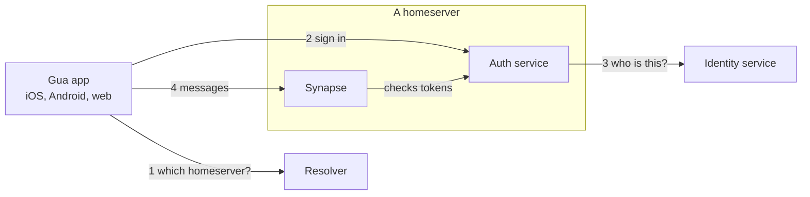
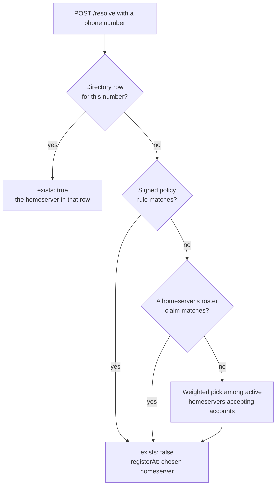
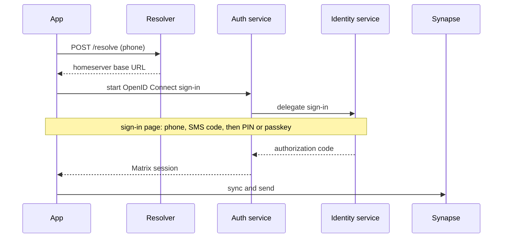
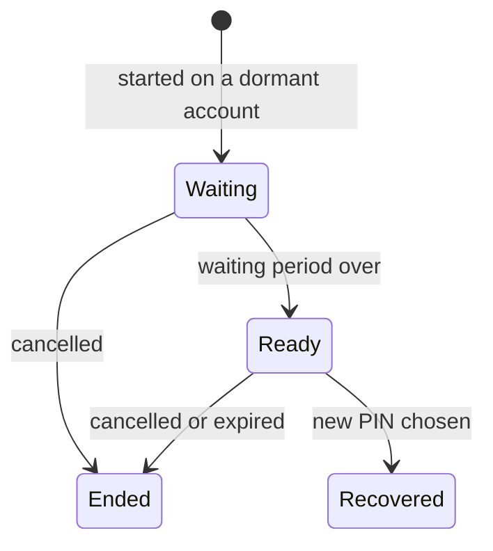

# Gua identity and federation

This guide describes account identifiers, hosting, sign-in and federation in the current system. Planned features are labelled separately.

## The parts



| Part | Repository | Responsibility |
| --- | --- | --- |
| Resolver | `gua-resolver` | Publishes the homeserver roster and routing rules. Returns a homeserver for a phone number. Stores no credentials or sessions. |
| Synapse | upstream | The Matrix account, rooms, encrypted messages, device list and encrypted key backup. |
| Auth service | `gua-auth-service`, a fork of Matrix Authentication Service | Manages Matrix sessions and access tokens. Each homeserver has an auth service. |
| Identity service | `identity-service` | Phone verification, PIN, passkeys, account recovery, usernames, contact discovery and the account identifier. One serves every homeserver. |
| Sign-in page | `gua-idp-web` | The web page the identity service uses for sign-in, shown by the apps in a system browser sheet. |

One operator runs all of these today.

## What a Gua account is

A Gua account consists of a person's profile, conversations and credentials. It is created during signup after phone verification and is hosted on exactly one homeserver.

An account has four identifiers:

| Identifier | Example | Who sees it | Purpose |
| --- | --- | --- | --- |
| Username | `maria` | Everyone | The public identity. |
| Phone number | `+55 11 98765 4321` | The identity service | How the owner signs in, and how people who already have the number find them. |
| Matrix ID | `@maria:gua.example` | Nobody, in the product | The address the Matrix protocol uses. |
| Account identifier | `ga1aea…`, 58 characters | Not displayed | A permanent internal identifier, unchanged by a phone number change. |

## The public identity

A person is known on Gua by a **username** and a display name. The username is chosen at signup: 3 to 30 characters from lowercase letters, digits, dot, underscore and dash, not all digits. It is unique, ignoring case, across every homeserver that shares the identity service.

People find each other by username, or through contact discovery: the app sends the numbers in the address book over TLS, and the identity service answers with the ones that have accounts. An account can opt out of being found this way.

The phone number is private and can change without creating a new account.

## The Matrix ID

Gua is built on Matrix, and Matrix addresses every user as `@localpart:server`. The localpart is the username. The server is the Matrix name of the homeserver that holds the account. Rooms, messages and device keys all refer to this ID, and every message is signed by the server it names.

Two consequences:

- The apps hide it. Screens show the username without the server and never say "Matrix ID".
- It is permanent. Changing the homeserver would change the Matrix ID. Gua does not support moving individual accounts between homeservers. See [planned federation work](planned-federation-work.md#moving-an-account-to-another-homeserver).

The Matrix ID is also the subject the identity service reports to the auth service when someone signs in.

## What the homeserver owns

A homeserver is Synapse plus its auth service.

- **Synapse** holds the account's rooms, memberships, encrypted messages, device list, public device keys and an encrypted backup of message keys. It cannot read message content.
- **The auth service** issues and revokes Matrix sessions. Synapse accepts no password of its own and trusts only tokens from its auth service.

The auth service stores no user credentials. It delegates sign-in to the identity service over OpenID Connect and creates the Matrix user on first sign-in using the returned username. The homeserver manages account data and sessions; the identity service authenticates users.

## What the resolver does

The apps request a homeserver from the resolver before phone-based sign-in. They do not hardcode a homeserver address for this lookup.

The resolver publishes:

- **The roster** (`GET /roster`): homeservers admitted to host Gua accounts, with their ids, Matrix server names, base URLs, auth issuers, regions and statuses. The resolver operator signs the roster.
- **The routing policy** (`GET /policy/routing`): signed rules for assigning new accounts by phone prefix, institution domain or sign-on issuer. Institution and issuer rules require a routing claim signed by a trusted key, bound to the phone number, valid for at most five minutes and accepted only once.
- **A transparency log** (`GET /roster/log`): an append-only record of roster and policy changes. Each entry is hashed into a Merkle tree. Comparing checkpoints with an earlier copy can detect rewritten history.

The resolver does not receive verification codes, PINs or passkeys, or issue sessions.

## How a phone number is resolved



```sh
curl -s -XPOST https://resolver.example/resolve \
  -H 'content-type: application/json' -d '{"phone":"+5511987654321"}'
```

```json
{
  "exists": false,
  "homeserver": null,
  "registerAt": {
    "serverName": "gua.example",
    "baseUrl": "https://matrix.gua.example",
    "masIssuer": "https://account.gua.example",
    "region": "br"
  }
}
```

What to know about this answer:

- **Read-only directory.** The directory maps keyed phone number hashes to homeserver ids for a fixed set of older numbers. New entries cannot be added.
- **Directory result.** `exists: false` means there is no directory row; an account may still exist. Without a row, the resolver evaluates routing rules. The app starts sign-in at the returned homeserver, and the identity service distinguishes returning users from new users.
- **Weighted selection.** Given the same number and federation state, resolvers return the same homeserver. Selection is reseeded when the transparency log grows. This selects the server for account creation; it does not change an existing Matrix ID.
- **Username lookup.** The identity service maps usernames to Matrix IDs. The roster specifies each homeserver's visibility for searches across homeservers.
- **Public endpoint.** No session is required. The limits are 20 requests per minute per client address, with IPv6 grouped by /64, and 200 requests per second per resolver pod. Rate-limited requests receive `429`, `Retry-After` and a fixed response body without parsing the submitted phone number. Both apps use `exists` to choose between sign-in and signup. Configuration is under `gua.resolver.abuse.*`; `ResolveAbuseControlsTest` verifies this behavior.

Signed account placement records are implemented but disabled. See [account identifiers and placement records](../specs/account-identifiers-and-placement-records.md).

## How sign-in works



- **An SMS code is insufficient for sign-in.** It proves current control of the number, including after a SIM swap. Sign-in also requires a passkey, a PIN, creation of the first factor during signup, or completed recovery.
- **New account:** choose a username, then register a passkey. Whoever cannot or will not use a passkey must set a PIN.
- **Returning account with a PIN:** enter the PIN, or use a passkey instead.
- **Returning account with only a passkey:** the passkey is required.
- **Passkey first:** a user can sign in with a passkey without typing a number. No SMS is sent. This path skips the resolver and uses the app's default homeserver.
- **Fresh authentication.** The apps use ephemeral browser sessions and request a new login each time.

## Account security

| Factor | What it proves | Rules |
| --- | --- | --- |
| SMS code | Control of the phone number now | 6 digits, 5 minutes, limited sends per number and per address. Never sufficient alone. |
| PIN | Knowledge | 6 digits. Repeated, sequential and common PINs are refused. 5 wrong attempts lock it for 15 minutes. |
| Passkey | Possession of a registered device or credential manager | WebAuthn, verified by the identity service. The relying party ID is the Gua brand domain, and the sign-in host is the allowed origin. |

Passkey verification does not validate signature counters or require trusted authenticator attestation. Any authenticator model is accepted.

A passkey uses the permanent **account identifier** as its user handle. Each account receives an identifier derived from random bytes at creation. Routing, login identifiers and token claims do not use it. See [account identifiers and placement records](../specs/account-identifiers-and-placement-records.md) for the format.

Account security changes require additional verification beyond an active session:

- **Adding a PIN or passkey from settings** needs a step-up first: an existing passkey, else the PIN, else an SMS code to the account's own number when it has no factor.
- **Deactivating, resetting encryption or changing the number** each need a fresh SMS code scoped to that one operation.
- **Changing the number** also needs a passkey or the PIN, then a code sent to the new number, and is limited to once per 24 hours.
- **Number changes require a PIN or passkey registered at least seven days earlier.** A newly added factor cannot authorize a number change.

## Devices and message keys

Messages are end-to-end encrypted with Matrix's encryption. Each device generates its own keys. The homeserver holds public device keys and an encrypted backup of message keys, and can read neither the messages nor the backup.

A new device restores earlier messages from an existing signed-in device after verification by comparing emoji. Gua does not display a recovery key. The six-digit account PIN is unsuitable for protection against offline guessing and is not used to encrypt message keys.

Without another device, the user resets the encrypted backup. Messages saved only in that backup are lost, messages already on a device are unaffected, and contacts are told that the person's security details changed.

## Changing device or losing access

| Situation | What happens |
| --- | --- |
| New phone, same number, PIN or passkey available | Sign in, then restore earlier messages from the old device. |
| No other device to restore from | Sign in and reset the encrypted backup. The account, contacts and conversations remain. Messages saved only in the backup are lost. |
| New phone number, still signed in | Change the number in settings. Username, Matrix ID and conversations are unchanged. |
| PIN forgotten or passkey lost, number still held | Delayed account recovery, below. |
| Someone else gets the number: SIM swap or a recycled number | They receive codes and cannot finish sign-in without the PIN or passkey. They can start recovery only on a dormant account, and the owner can cancel it. |
| Number, PIN and passkey all lost | Account recovery is unavailable. |

### Delayed account recovery

For someone who proved the number by SMS code and cannot present the PIN or passkey.



- It can start only when the account has had no completed sign-in for the dormancy period, and can finish only after the waiting period. Both default to 7 days and cannot be set below 24 hours outside development.
- While it is pending, every signed-in app shows a banner with a cancel button. Any sign-in with the PIN or a passkey also cancels it.
- Finishing sets a new PIN, removes every passkey and signs out every other session. The new PIN then falls under the 7 day rule above.
- Starting it sends no SMS, and nothing shortens the two waits.

## Federated versus local

| | Scope today |
| --- | --- |
| Messages and rooms | Gua's homeservers currently exchange messages and room events with other Matrix servers through federation. |
| Matrix federation policy | Each operator sets its policy: open, restricted to selected servers, or disabled. Restricting Gua's homeservers to roster members is planned. |
| Roster, routing policy, transparency log | Federation-wide, published by the resolver. |
| Matrix account, sessions, devices, key backup | Local to one homeserver. |
| Sign-in, PIN, passkeys, recovery, usernames, contact discovery, account identifiers | Central. One identity service serves every homeserver. |
| Who may join or leave the roster | The resolver operator. |

## How a resolver answer can be checked

- Roster verification requires a configured minimum number of valid signatures from the operator's keys.
- Each roster includes the transparency log size and root hash. Consistency proofs verify that a later checkpoint extends an earlier checkpoint.
- A routing policy bundle is signed, appears in the log, and limits each delegated rule set to the homeservers and scope it was granted.
- Homeserver signatures allow verification of each server's address and key independently of the resolver operator. This is implemented; enforcement remains optional until all homeservers have signed their entries.
- Membership changes can require governance signatures from keys stored outside the resolver. Apps would pin the federation trust root. This is implemented but disabled.

The [verification protocol](../verification/gua-resolver-verification-protocol.md) is the step by step algorithm. The byte formats are in [signed federation objects](../specs/federation-signed-objects.md).

Limits to keep in mind:

- The apps do not run these checks yet. They use the resolver's answer as received.
- All keys are controlled by one operator. Verification does not provide independence from that operator.
- For an `exists: true` response, roster verification establishes that the homeserver is active. It does not establish that the account is hosted there.
- The stored phone hashes can be reversed by anyone who holds both the stored values and the secret they are keyed with.

See [planned federation work](planned-federation-work.md) for proposed changes.

## In development: account authority

Open pull requests in the resolver, identity service, apps and sign-in page add device-held account signing keys and an append-only key history. Adding or removing a device requires approval from an already trusted device. Phone number control alone cannot authorize these changes. The feature is disabled and unused; the current system described above does not depend on it.
