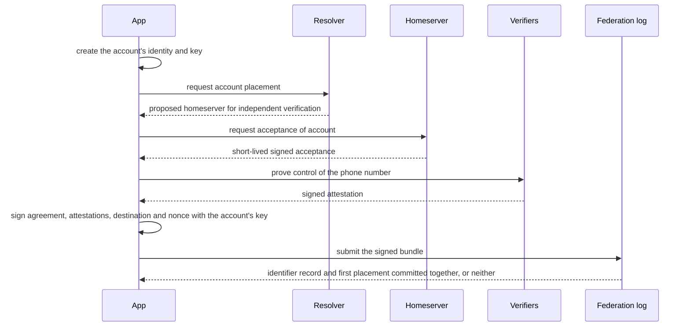
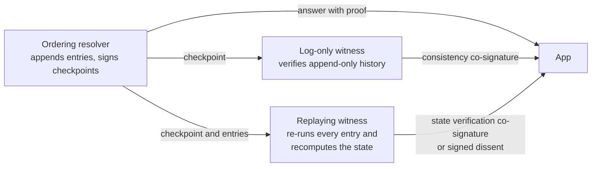

# Federation work that is not built yet

Proposed changes to the system described in [Gua identity and federation](gua-identity-and-federation.md). Each section lists the current limits, implementation requirements and dependencies. Features are unimplemented unless stated otherwise. See the [migration plan](../migrations/gua-resolver-migration-plan.md) for the order of work.

One operator currently runs every service and controls every key. Guarantees that require independent operators are not yet available.

## Identifier ownership attested by independent verifiers

The identity service directory is currently the only record associating phone numbers with accounts.

The proposed design uses signed records from governance-accredited verifiers. Each verifier checks control of an identifier and signs an attestation. A governance-signed policy specifies the required number of independent verifier operators, allowed proofs and challenge freshness for each identifier type. Forging a record for an unused identifier would require compromising the required verifier operators or enough governance keys to change the policy.

Rules:

- Reassignment of a phone number does not transfer the previous account, history or credentials, or change its homeserver.
- Verifiers under common control count as one operator, regardless of the number of keys or operator ids.
- Verification requires the specified key set. A missing key set must cause rejection.
- Verifiers attest current control of a phone number. Additional verifiers do not protect against a SIM swap.

Undecided: the verifier threshold for each identifier type. Deployment requires governance enforcement and a second independent operator.

## New accounts registered as one checkable transaction

The resolver currently evaluates policy for each request without recording the selected homeserver. Its weighted fallback uses the roster version, equal to the transparency log size, as a seed. Appending a log entry can change the selection.

The design:

Rules:

- The destination must remain fixed throughout the transaction. Apps must independently reproduce the resolver's selection from the signed policy and roster.
- The applicant signs the transaction fields and nonce to bind the request and prevent replay. The destination homeserver signs its acceptance of that account for the transaction and controls its own admissions. Neither signature proves control of the phone number.

[Placement records](../specs/account-identifiers-and-placement-records.md#placement-record-66--n-bytes) are implemented. When enabled, they are compared daily with actual account hosting. Their use in routing requires the conditions in the [migration plan](../migrations/gua-resolver-migration-plan.md#phase-4-placement-records-for-existing-accounts).

## Apps verifying before they connect

The apps currently pass the resolver's `baseUrl` directly to the Matrix SDK. The [verification protocol](../verification/gua-resolver-verification-protocol.md) and Java reference verifier define the available checks. No app performs them yet.

Before connecting, apps should verify the pinned federation root, roster, homeserver signature and placement record. Initial deployment should report verification failures without blocking connections.

Undecided: how apps distinguish legitimate homeserver key changes from takeovers, and how they accept newer federation roots while rejecting downgrades.

## Checkpoints, witnesses and replicas

The transparency log currently proves that a sequence of hashes is append-only. It does not verify current state. Directory changes are not logged, timestamps use the resolver's clock, and negative account lookup responses are unsigned. Clients do not detect conflicting histories. Mirror mode is implemented but untested.

The proposed design uses one ordering resolver, log-only and replaying witnesses, and a sparse Merkle tree with proofs for account existence and absence.

History consistency, availability, ordering, state correctness and censorship detection require separate checks:

| Property | What provides it | Broken by |
| --- | --- | --- |
| The state is computed correctly | Deterministic rules and independent replay | The ordering operator plus every replaying witness the app requires |
| Everyone sees one history | Witness co-signatures, apps pinning checkpoints, consistency proofs | The ordering operator plus enough witnesses under one control, or apps that never compare |
| Nothing is censored | Not prevented. Only detectable | The ordering operator alone |
| Service availability | Not provided by witnesses | The ordering operator alone |
| Entries have one order | The ordering resolver | The ordering operator alone |

Rules:

- A checkpoint signature authenticates the checkpoint. It does not establish correct state computation.
- A state verification signature requires fetching, verifying and replaying every entry, then recomputing state. The witness signs the log size it verified. Failed verification must prevent signing; a state mismatch requires a signed dissent.
- Clients must distinguish log-only signatures, which verify history consistency, from state verification signatures.
- Governance must attest each witness's type and operator. Clients must verify that identity against the federation root before accepting a witness signature.
- Witnesses controlled by the resolver operator do not count toward independent verification.
- Any two accepted witness sets must share at least one honest operator.
- Every state input, including time, must be recorded in the log. The ordering resolver must record timestamps according to a time policy rather than choose arbitrary values. Logged time must be monotonic and checked against that policy during replay. Replay must not use the local clock.
- Additional resolvers may improve availability but do not increase signing authority. Replica keys do not count toward signature thresholds.

Proposed details, not yet reviewed:

- **One checkpoint per size.** A log-only witness refuses to co-sign a second checkpoint at a size it already co-signed.
- **Quorum.** For a set of witness operators `W` and at most `f` faulty operators, the required number of signatures `q` satisfies `2q - |W| >= f + 1`. With four operators and one faulty operator, three signatures are required. Any two accepted sets then share two operators, including at least one honest operator. Initial deployment would use one independent operator with `q = 1` and `f = 0`.
- **Pinning.** An app pins the last checkpoint it accepted for the federation, not per account, and moves forward only on a consistency proof and a quorum.
- **Time.** A `TICK` entry is appended at least every 60 seconds. A witness co-signs only when the checkpoint's time is within 120 seconds of its own clock. A clock disagreement prevents signing but does not produce a dissent.
- **Dissent.** Clients can verify the last agreed checkpoint, disputed checkpoint, first invalid entry and evidence included in a signed dissent.
- **Evidence of censorship.** An accepted input gets a signed promise that it will appear in the log within a stated delay. An unmet promise proves censorship.

Multiple ordering nodes are needed only if the federation requires independent control of ordering or continued operation despite a malicious ordering operator.

A replica design must specify trust root setup, checkpoint discovery, snapshot verification, replay and fork handling. It must distinguish read-only replicas from nodes with signing authority. Obtain the root out of band and compare its fingerprint over two independent channels, then verify the governance key chain and witness list. Replay all entries, or recompute a snapshot's root and compare it with a checkpoint signed by replaying witnesses before replaying later entries. Stop on a fork and publish the evidence.

The formats can be implemented before a second operator joins. Independent verification requires that operator.

## Phone numbers that cannot be recovered from stored state

The resolver and identity service currently store HMAC-SHA256 phone number hashes using a shared secret pepper. Anyone with the hashes and pepper can enumerate a national numbering plan of roughly one to ten billion candidates to recover the numbers. Changing the pepper requires the raw numbers. `POST /resolve` is unauthenticated, exposes account lookup information and uses per-client, global and ingress rate limits.

Requirements:

1. No raw or cheaply reversible identifier appears in state that leaves the operator.
2. Turning a number into its lookup key requires an online evaluation that the evaluator can meter without learning the number.
3. Routine rotation of operators or key shares leaves every lookup key unchanged.
4. With a second evaluator operator, no single operator may control the whole key.
5. The app obtains the evaluation public key from the pinned federation chain, not from the evaluator.
6. All apps must use the same public key for a generation. The evaluator must not assign different keys to different clients.
7. Generations only move forward. An app refuses an older one.
8. Identifier uniqueness must be preserved across generation changes.
9. Emergency re-keying uses only parties that already hold the identifier: the account's own app or an accredited verifier.
10. Controls on `/resolve` are layered, and none may assume an account session, because the endpoint is needed before any session exists.

The proposed design uses a verifiable oblivious pseudorandom function, defined for a single server in RFC 9497. Multiple operators would compute its output using shares of one key. Refreshing shares must preserve stored lookup keys. RFC 9497 does not specify key sharing or share refresh; this combination requires cryptographic review before implementation. Changing the construction later would affect every stored lookup key.

Proposed constraints, subject to that review:

- **No updatable construction.** Do not use a public token to re-key stored values.
- **Emergency re-keying.** Governance signs a new generation and stops new bindings under the old one. Each identifier is bound again with verifier attestations that link its old and new lookup keys. Identifiers bound again stay linkable by anyone who holds the old key. Only identifiers first bound afterwards gain protection.
- **Process separation.** The evaluator has its own process and keys. The resolver must not store a key share.

## Sign-in decided by each homeserver, and passkeys

Today the identity service authenticates users for every homeserver and verifies every passkey. The passkey relying party ID is the Gua brand domain, and the sign-in host is the allowed origin.

Rules for moving authentication to each homeserver:

- Account lookup, homeserver placement and authentication are separate operations. The federation may provide lookup and placement information. Only the homeserver authenticates the user and grants a session.
- A federation-issued artifact must not be sufficient to obtain a session or establish that a user is present. The homeserver must authenticate the user independently. A homeserver's own SMS sign-in does not violate this separation.
- Homeserver discovery must precede the passkey ceremony. Passkeys are specific to a relying party, and platforms do not list them across relying parties.
- Homeserver discovery must not store credential keys, receive passkey assertions, enable account enumeration or record identifiers in shared state.
- Apps must verify the homeserver against the pinned federation chain before using a stored discovery hint.
- Passkey sign-in must authenticate an existing account. It must not create one.
- A passkey's relying party is fixed at registration. Homeservers run by Gua retain the Gua relying party for existing passkeys. Other operators use relying party IDs they control, unrelated to Gua's.
- Each homeserver allows only its own web origins plus the first-party apps, and publishes its relying party ID and origins in its self-signed roster entry.
- An assertion made for one operator never yields a session at another, including by relaying an assertion from a native app.
- A homeserver's self-signed roster entry never makes it eligible for a native passkey ceremony under the Gua relying party. A browser enforces origin for web ceremonies. A native ceremony uses the app's compiled association and does not.
- Admitting a third-party operator needs no app release. Its users run web ceremonies on its own origin.
- Migrate existing passkey records from the identity service to the account's homeserver without changing the relying party ID or requiring re-enrolment.
- The auth service identifies upstream links by provider and subject. Changing subject semantics requires a new provider and an explicit account linking migration, not an in-place subject edit.
- **Localpart derivation.** The auth service uses the returned username as the Matrix localpart. Deriving that username by splitting the user id at a colon could assign the same localpart to every returning user after an identifier format change. With `on_conflict: add`, the auth service could then merge those users into one account. `LocalpartDerivationGuardTest` in identity-service rejects this derivation.

The per-homeserver authentication design is incomplete, including the identity service's remaining responsibilities.

## Moving an account to another homeserver

Gua does not support moving individual accounts between homeservers. Capacity changes currently use relocation of a whole homeserver, preserving Matrix IDs and keys.

A Matrix ID includes the server name. Events are signed by the sender's server, and the auth service does not rename users. No adopted Matrix feature transfers device keys, verification, room membership or message attribution between servers. An account move would require a new Matrix ID and device keys, re-established conversations and contact verification. Earlier messages would retain the old sender.

Rules if this is ever built:

- A move requires authorization from the account's signing key. An operator cannot authorize it, and an account without a key cannot move.
- A move changes neither the account identifier nor which identifiers belong to the account.
- A move is a next-generation placement record entered in the log, never a session grant. The destination agrees to host and authenticates the person from scratch.
- Tooling runs on the user's devices through the ordinary client API, with no admin API and no trust between operators.
- A move can be abandoned without loss until the old homeserver deactivates the account.
- The old Matrix ID is never given to anyone else.
- Tools and screens must explain the change of Matrix identity. Any claim to preserve keys, verification or history requires validation against the deployed versions.
- The next-generation placement record includes the account identifier, destination homeserver id, generation, previous record hash, account signature, destination's signed acceptance and logged time. It excludes the Matrix ID and does not establish continuity of device keys or verification.

Revisit when a second operator exists, when a regional or legal requirement demands it, or when Matrix merges a portability proposal that Synapse supports in a room version Gua can adopt.

## Losing the governance keys

Loss or compromise of governance keys beyond the rotation rule requires a new federation trust root and app builds that pin it. The treatment of existing accounts and placements remains undecided and requires a governance policy before a protocol design.

## Account authority and device lifecycle

This feature is in development on open pull requests and is disabled. See the [architecture guide](gua-identity-and-federation.md#in-development-account-authority). Requirements:

- Phone number control must not authorize account key changes, alone or in combination with other steps.
- Operator actions, homeserver actions and elapsed time must not authorize account key changes. An operator may suspend an account but must not reassign it.
- Adding the first account key requires fresh strong proof on the owner's device and a waiting period with notification and an opportunity to object. A homeserver or operator must not add the key on the owner's behalf.
- Recovery must follow previously committed rules. Competing key changes must use a fixed ordering rule, independent of signature arrival time.
- Recovery cancellation rules must be committed in advance and must not depend solely on the potentially compromised key.
- Once a stronger factor is committed, weaker factors cannot authorize key changes.
- Waiting periods on key changes run on time recorded in the federation log, which witnesses can replay. Until witnesses exist they run on service time.
- Losing every committed factor may be final.

The design must cover additional, lost and replacement phones; QR or trusted-device approval; recovery; web login; and browser sessions. Browser access must not automatically grant account signing authority.

The proposed ordering rules require a formal model and review:

- **Rotate.** Signed by the active key alone. Immediate, cannot change the recovery policy, and refused while a recovery or a policy change is pending.
- **Recover.** Needs the committed number of recovery factors, takes effect after the recovery wait, installs a new active key and cancels any pending policy change.
- **Change the recovery policy.** Needs the active key plus one committed factor and takes effect after the policy wait. Lengthening a wait applies at once. Shortening one takes effect only after the policy wait.
- **Rank** is the number of distinct committed factors that signed. A higher rank cancels a pending change. An equal rank cancels both and freezes key changes for the recovery wait. A lower rank is refused. Each cancelled attempt doubles the wait before the same signers may try again.
- **Recovery framework `0x02`** would commit a set of recovery factor keys, how many must sign, and bounds on both waits. Every committed factor is a public key, never a hash of a secret. An account under framework `0x01` follows the same order with its one recovery key and both waits fixed at 7 days.
